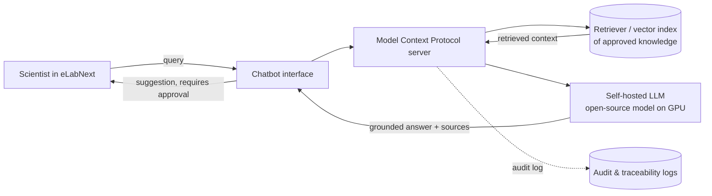

## **Learning Outcomes Addressed**

1. Explain how AI can be strategically integrated into organizational functions to create business value
2. Evaluate the suitability of AI technologies for specific organizational use cases
3. Analyze the cost, security, and operational implications of AI adoption
4. Assess the human and organizational factors that influence successful AI implementation
5. Synthesize course concepts into a structured approach for organizational AI adoption

**The Capstone**

**Brief description:** This assignment is **mandatory** and **will be evaluated** as part of your final grade. This assignment must be completed **individually**. Before attempting the assignment, you should study the module content.

### **Introduction**

We have reached the end of the course. Your final project will consolidate the knowledge, skills, and frameworks you have developed while tailoring them to the specific context of your organization.

Throughout the course, you have completed practical exercises with AI tools and examined critical considerations such as cost, security, employee adoption, change management, and KPIs. This final assignment builds on that work.

Rather than creating entirely new material, your task is to bring together your previous ideas and apply them in a coherent, actionable plan for AI adoption.

### **Instructions**

You will create a two- to five-page document outlining how you would integrate AI into a function or process within your organization. Please include the following:

- **Context** 
    - Identify your sector and type of organization. 
    - Specify the department, process, or function where AI will be implemented.
- **Technology choice** 
    - State which AI system(s) you will use, and why. 
- **Cost considerations** 
    - Provide an estimated cost, including capital expenditure, operational expenses, and any staffing or training costs. 
- **Security plan** 
    - Outline how you will address data privacy, cybersecurity, and risk mitigation.
- **Change management and training** 
    - Describe your plan for employee adoption, communication, and training.
- **Scaling strategy** 
    - Explain how you will roll out the implementation, using the “crawl, walk, run” maturity model.
- **Governance and compliance** 
    - Describe how you will ensure compliance with relevant regulations and governance standards.
- **KPIs** 
    - Identify the measurable indicators you will use to evaluate the success of your AI implementation. 

### **Submission Instructions**

**Format:** Word/PDF document 

**Submit your work:** To upload your work, click on "Start assignment" at the top right corner of the page. You must attach the document, then click on "Submit assignment" again.

The average time to complete this assignment is 120 minutes.

## Rubric

Required Assignment 8.1: The Capstone

Required Assignment 8.1: The Capstone
|Criteria|Ratings|Pts|
|---|---|---|
|This criterion is linked to a Learning Outcome The learner explains how AI can be strategically integrated into a specific organizational function by clearly describing the sector, organization type, and targeted department, process, or workflow.|\|   \|   \| \|---\|---\| \|0 pts  Complete\|0 pts  Incomplete\||0 pts|
|This criterion is linked to a Learning Outcome The learner evaluates the suitability of selected AI technologies by identifying the system(s) chosen and explaining why they fit the specific use case.|\|   \|   \| \|---\|---\| \|0 pts  Complete\|0 pts  Incomplete\||0 pts|
|This criterion is linked to a Learning Outcome The learner analyzes cost, security, and operational implications by addressing estimated costs (capital, operational, and staffing/training), data privacy, cybersecurity, and risk mitigation considerations.|\|   \|   \| \|---\|---\| \|0 pts  Complete\|0 pts  Incomplete\||0 pts|
|This criterion is linked to a Learning Outcome The learner assesses human and organizational factors by addressing employee adoption, communication, training, and change management considerations.|\|   \|   \| \|---\|---\| \|0 pts  Complete\|0 pts  Incomplete\||0 pts|
|This criterion is linked to a Learning Outcome The learner synthesizes course concepts into a structured AI adoption approach by integrating scaling strategy (crawl, walk, run), governance and compliance considerations, and KPIs into a coherent plan.|\|   \|   \| \|---\|---\| \|0 pts  Complete\|0 pts  Incomplete\||0 pts|
|This criterion is linked to a Learning Outcome The submission meets four of the five criteria listed above.|\|   \|   \| \|---\|---\| \|1 pts  Complete\|0 pts  Incomplete\||1 pts|

## 1
# Capstone: AI Research Assistant for eLabNext

*Draft — Context, Technology, and Cost Considerations sections. Builds on Assignment 3.1 (AI Protocol Assistant proposal) and Assignment 4.1 (NIST AI Risk &amp; Security Plan).*

---

## 1. Context

### Background

The R&amp;D organisation already operates an Electronic Lab Notebook (ELN), eLabNext, to record experiments, store research data, and manage SOPs, templates, and sample metadata. As established in Assignment 3.1, scientists currently spend significant time writing protocols, documentation styles vary across the team, and this inconsistency makes experiments harder to reproduce and increases peer-review effort.

The earlier AI Protocol Assistant addressed one part of this problem — helping scientists *draft* protocols using approved organisational knowledge. The capstone extends that work in scope: from a protocol-drafting assistant into a **research-assistant chatbot** that supports a broader set of R&amp;D knowledge work while remaining embedded in the same validated laboratory environment.

### Problem and Opportunity

Researchers — particularly new and Masters-level staff — face a recurring set of knowledge bottlenecks:

- Locating and reconciling relevant prior protocols, publications, and draft work.
- Interpreting SOPs and applying them correctly to a new experiment.
- Maintaining documentation consistency and reproducibility across the team.
- Onboarding new researchers into departmental conventions and terminology.

These tasks consume time that would be better spent on scientific work, and inconsistent documentation increases downstream review burden and reproducibility risk. An AI research assistant that is grounded in the organisation's *own* approved knowledge can reduce this burden while keeping a human responsible for final decisions.

### Strategic Value

The assistant creates business value by:

- **Productivity**: reducing time spent searching, drafting, and reconciling documentation.
- **Quality and reproducibility**: standardising protocols and surfacing approved SOPs and templates, directly supporting the department's research-quality goals.
- **Onboarding and knowledge transfer**: giving newer researchers on-demand access to departmental expertise and conventions, reducing reliance on senior staff availability.
- **Continuity**: operating within the existing eLabNext environment so it complements, rather than replaces, established workflows.

### Scope Boundaries

Consistent with Assignment 4.1, the assistant:

- Operates as an **assistant to scientists**, not an autonomous decision-maker. It does not independently approve, publish, or execute laboratory procedures.
- Retains **human-in-the-loop approval** for any AI-generated output before it is adopted.
- Uses **read-only access** to approved resources and inherits the user's role-based permissions within eLabNext.
- Stays within the organisation's validated laboratory management system for authentication, authorisation, and audit logging.

### Target Users

Primary users are R&amp;D scientists and Masters-level researchers working in eLabNext. The assistant adapts its level of detail to the user's experience — offering more guidance to new researchers and concise recommendations to experienced scientists — and adopts a friendly, approachable tone suited to a research-assistant persona.

---

## 2. Technology

### Approach: Reasoning Text-Generative Chatbot with RAG

The assistant is a **reasoning, text-generative chatbot** built on a **Retrieval-Augmented Generation (RAG)** architecture. Rather than relying solely on a model's parametric memory, the assistant retrieves relevant context from the organisation's approved knowledge base and grounds its responses in those sources. This keeps answers traceable, current, and aligned with approved SOPs — and directly supports the security and auditability requirements established in Assignment 4.1.

### RAG vs Fine-Tuning — Design Decision

Two mechanisms were considered for giving the assistant organisation-specific knowledge:

| Mechanism                              | Strengths                                                                                                                                            | Weaknesses                                                                                                           |
| -------------------------------------- | ---------------------------------------------------------------------------------------------------------------------------------------------------- | -------------------------------------------------------------------------------------------------------------------- |
| **Fine-tuning** (model weight updates) | Encodes tone/style and domain fluency into the model                                                                                                 | Expensive, requires GPU retraining, knowledge goes stale, hard to audit or correct, risks overfitting to recent data |
| **RAG** (retrieve and ground)          | Cheaper, knowledge stays current by updating the index, fully traceable to source documents, easy to correct/remove content, aligns with audit model | Does not by itself shift tone/style; retrieval quality depends on indexing and chunking                              |

**Decision:** Use **RAG as the primary knowledge mechanism**, grounded in approved organisational sources. Reserve **lightweight fine-tuning for a later phase**, if needed, to nudge the assistant's tone and style toward a "friendly Masters-student-level research assistant" persona — but keep domain *knowledge* in the retrievable index, not in model weights. This keeps knowledge current, auditable, and correctable without recurring retraining cost, and avoids storing potentially sensitive research data inside model weights (an IP-risk consideration from Assignment 4.1).

### Knowledge Sources (Retrieval Corpus)

The RAG index is built from approved, in-scope organisational knowledge:

- Previous protocols and approved draft work.
- SOPs and version-controlled protocol templates.
- Relevant internal publications and departmental guidelines.
- Sample metadata and experimental results the user is authorised to access.
- Lab terminology and conventions.

Access is governed by the same role-based permissions as eLabNext; the assistant only retrieves documents the active user is authorised to view. External internet resources remain disabled unless explicitly enabled, and HR, financial, and personal employee data are excluded entirely (per Assignment 4.1).

### Architecture Overview

The assistant connects to data sources through a **Model Context Protocol (MCP) server**, reusing the approach proposed in Assignment 3.1. Every retrieval and generation is logged so each output can be traced back to its source documents, prompts, and model output — supporting the decision-traceability and output-evaluation controls from Assignment 4.1.

### Deployment Model

The LLM is **self-hosted as an open-source model on the organisation's own GPU infrastructure**. This keeps research data on-premise, avoids sending sensitive IP to third-party APIs, and gives the organisation control over model versions, availability, and cost. The retriever/index and MCP layer also run on internal infrastructure. If the AI service becomes unavailable, scientists continue using the existing ELN workflow without disruption (a resilience requirement from Assignment 4.1).

### Human-in-the-Loop and Safety Controls

- All AI-generated suggestions are clearly labelled and require **user approval** before being saved.
- The assistant operates with **read-only access** to approved resources.
- Recommendations are **grounded in cited SOPs/sources**; unsupported recommendations are flagged.
- Public-health-sensitive outputs require **human scientific review and lab-safety-officer review** before release (per Assignment 4.1 IP/public-health risk controls).

---

## 3. Cost Considerations

Cost is driven by three areas: **infrastructure (GPU compute)**, **development and data engineering**, and **ongoing operation and maintenance**. Because the model is self-hosted, the cost profile differs markedly from a per-token cloud API model: costs are dominated by fixed hardware and engineering rather than variable usage fees.

### 3.1 Infrastructure (Hardware and Hosting)

| Item                                | Nature                 | Cost driver                              | Notes                                                                                       |
| ----------------------------------- | ---------------------- | ---------------------------------------- | ------------------------------------------------------------------------------------------- |
| GPU server(s) for inference         | Fixed (CapEx or lease) | Model size, concurrency, latency targets | Open-source model self-hosted; sizing depends on chosen model and expected concurrent users |
| Vector database / retrieval index   | Fixed + minor variable | Corpus size, indexing frequency          | Index of approved protocols, SOPs, publications; re-index on update                         |
| Storage for corpus, logs, backups   | Fixed                  | Data volume, retention period            | Daily local backups retained 6 months (per Assignment 4.1)                                  |
| Networking / power / rack (on-prem) | Fixed                  | Hardware footprint                       | Applies if hosted on internal infrastructure                                                |

**Implication:** Self-hosting shifts cost from per-token variable fees (cloud API) to upfront and fixed infrastructure. This is cost-predictable and keeps data on-premise, but requires capital outlay or leasing and in-house capacity to operate GPU hardware. If usage is low, a cloud API model would be cheaper; self-hosting becomes economical as usage and data-sensitivity needs grow.

### 3.2 Development and Data Engineering (One-Time / Phase-Based)

| Item                                                       | Cost driver                                                                                 |
| ---------------------------------------------------------- | ------------------------------------------------------------------------------------------- |
| Model selection, evaluation, and benchmarking              | Engineering time, evaluation datasets                                                       |
| MCP integration with eLabNext data sources                 | Engineering time; assessment of legacy data for secure reliable access (per Assignment 3.1) |
| RAG pipeline: chunking, indexing, retrieval tuning         | Engineering time; iterative quality work                                                    |
| Prompt engineering and persona/tone calibration            | Engineering time; user testing                                                              |
| Security, access-control, and audit-logging implementation | Engineering time (maps to Assignment 4.1 controls)                                          |
| User training materials and assessments                    | Content + delivery (Assignment 4.1 training requirement)                                    |
| Optional later-phase fine-tuning (tone/style)              | GPU time, data prep — deferred; only if RAG alone is insufficient                           |

### 3.3 Ongoing Operation and Maintenance

| Item                                                    | Nature    | Notes                                                                                                           |
| ------------------------------------------------------- | --------- | --------------------------------------------------------------------------------------------------------------- |
| Index refresh as new protocols/SOPs/publications arrive | Recurring | Keeps knowledge current; core advantage of RAG over fine-tuning                                                 |
| Monitoring of audit logs, performance, anomalies        | Recurring | Behavioural monitoring per Assignment 4.1                                                                       |
| Incident response and CAPA cycles                       | Episodic  | Per Assignment 4.1 governance                                                                                   |
| Model / dependency updates and security patching        | Recurring | Open-source model maintenance responsibility                                                                    |
| User support and feedback-driven refinement             | Recurring | Success metrics: writing time, review duration, revision cycles, adoption, acceptance rate (per Assignment 3.1) |

### 3.4 Cost Trade-Offs and Key Considerations

- **Self-hosted vs cloud API:** Self-hosting prioritises **data sovereignty and IP protection** over per-request cost efficiency. It is justified here by the sensitive research IP the assistant accesses; for low-volume use, a cloud API would be cheaper but would conflict with the on-premise data-handling posture.
- **RAG keeps recurring cost low:** Updating the retrieval index is far cheaper than retraining, and keeps knowledge current — the main reason RAG is preferred over fine-tuning as the primary mechanism.
- **Fine-tuning cost is deferred and optional:** It is treated as a later-phase, optional investment only if tone/style goals cannot be met through prompting and persona design.
- **Operational risk cost:** Self-hosting means the organisation owns availability, patching, and recovery. This cost is partly mitigated by the existing manual workflow fallback (Assignment 4.1), which limits the blast radius of any outage.
- **Success metrics justify spend:** Cost-effectiveness should be tracked against the value metrics from Assignment 3.1 (reductions in protocol writing time, review duration, revision cycles; adoption; user satisfaction) so the investment can be evaluated against delivered value.

---

*Next sections to draft: Security Plan (build on Assignment 4.1), Operational Plan, Human &amp; Organizational Factors, and Synthesis / Structured Adoption Approach.*